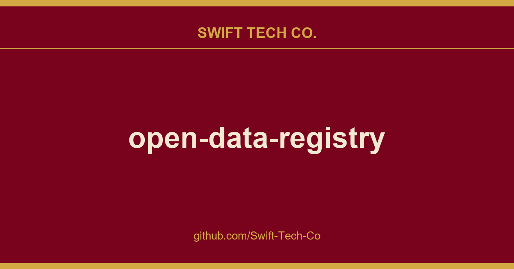

# open-data-registry

## What This Is

This is part of the Swift Tech Co. working stack for product and engineering. It gathers the open-data-registry notes, examples and fixes that keep delivery fast, and doubles as the reference map we hand to whoever picks up this thread next.

## Images

[](https://github.com/Swift-Tech-Co)

## What is this for?

When data is shared on AWS, anyone can analyze it and build services on top of it using a broad range of compute and data analytics products, including Amazon EC2, Amazon Athena, AWS Lambda, and Amazon EMR. Sharing data in the cloud lets data users spend more time on data analysis rather than data acquisition. This repository exists to help people promote and discover datasets that are available via AWS resources.

## How are datasets added to the registry?

Each dataset in this repository is described with metadata saved in a YAML file in the [/datasets](/datasets) directory. We use these YAML files to provide three services:

- A Registry of Open Data on AWS browser.
- A hosted YAML file listing all of the dataset entries.
- Hosted YAML files for each dataset.

The YAML files use this structure:

```yaml
Name:
Description:
Documentation:
Contact:
ManagedBy:
UpdateFrequency:
Tags:
  -
License:
Citation:
Resources:
  - Description:
    ARN:
    Region:
    Type:
    Explore:
DataAtWork:
  Tutorials:
    - Title:
      URL:
      NotebookURL:
      AuthorName:
      AuthorURL:
      Services:
  Tools & Applications:
    - Title:
      URL:
      AuthorName:
      AuthorURL:
  Publications:
    - Title:
      URL:
      AuthorName:
      AuthorURL:
DeprecatedNotice:
ADXCategories:
  -    
```

The metadata required for each dataset entry is as follows:

| Field | Type | Description & Style |
| --- | --- | --- |
| **Name** | String | The public facing name of the dataset. Spell out acronyms and abbreviations. We do not require "AWS" or "Open Data" to be in the dataset name. Must be between 5 and 130 characters.|
|**Description**|String|A high-level description of the dataset. Only the first 600 characters will be displayed on the homepage of the Registry of Open Data on AWS|
|**Documentation**|URL|A link to documentation of the dataset, preferably hosted on the data provider's website or Github repository.|
|**Contact**|String|May be an email address, a link to contact form, a link to GitHub issues page, or any other instructions to contact the producer of the dataset|
|**ManagedBy**|String|The name of the laboratory, institution, or organization who is responsible for the data ingest process. Avoid using individuals. If your institution manages several datasets hosted by the Public Dataset Program, please list the managing institution identically. For an example why, check out the Managed By section of the TARGET dataset|
|**UpdateFrequency**|String|An explanation of how frequently the dataset is updated|
|**Tags**|List of strings|Select tags that are related to an intrinsic property or descriptor of the dataset. A list of supported tags is maintained in the tags.yaml file in this repo. If you want to recommend a tag that is not included in [tags.yaml](tags.yaml), please submit a pull request to add it to that file.|
|**License**|String|An explanation of the dataset license and/or a URL to more information about data terms of use of the dataset|
|**Citation** (Optional)|String|Custom citation language to be used when citing this dataset, which will be appended to the default citation used for all datasets. Default citation language is as follows: "[DATASET NAME] was accessed on [DATE] at registry.opendata.aws/[dataset]"|
|**Resources**|List of lists|A list of AWS resources that users can use to consume the data. Each resource entry requires the metadata below:|
|**Resources > Description**|String|A technical description of the data available within the AWS resource, including information about file formats and scope.|
|**Resources > ARN**|String|Amazon Resource Name for resource, e.g. arn:aws:s3:::commoncrawl|
|**Resources > Region**|String|AWS region unique identifier, e.g. us-east-1|
|**Resources > Type**|String|Can be _CloudFront Distribution_, _DB Snapshot_, _S3 Bucket_, or _SNS Topic_. A list of supported resources is maintained in the [resources.yaml](resources.yaml) file in this repo. If you want to recommend a resource that is not included in [resources.yaml](resources.yaml), please submit a pull request to add it to that file.|
|**Resources > RequesterPays** (Optional)|Boolean|Only appropriate for Amazon S3 buckets, indicates whether the bucket has Requester Pays enabled or not.|
|**Resources > AccountRequired** (Optional)|String|Is an AWS account required to access this data? Note that while Requester Pays means you will need an account, this is meant for cases where an account is required outside of that scenario.|
|**Resources > ControlledAccess** (Optional)|String|Only appropriate for Amazon S3 buckets with controlled access. Please provide a URL to instructions on how to request and gain access to the S3 bucket.|
|**Resources > Explore** (Optional)|List of strings|Additional links that can be used to explore the bucket resource, i.e. links to S3 JS Explorer index.html for the bucket or the AWS S3 console.|
|**DataAtWork  [> Tutorials, Tools & Applications, Publications]**  (Optional)|List of lists|A list of links to example tutorials, tools & applications, publications that use the data.|
|**DataAtWork [> Tutorials, Tools & Applications, Publications] > Title**|String|The title of the tutorial, tool, application, or publication that uses the data.|
|**DataAtWork [> Tutorials, Tools & Applications, Publications] > URL**|URL|A link to the tutorial, tool, application, or publication that uses the data.|
|**DataAtWork [> Tutorials, Tools & Applications, Publications] > AuthorName**|String|Name(s) of person or entity that created  the tutorial, tool, application, or publication. Limit scientific publication author lists to the first six authors in the format Last Name First Initial, followed by 'et al'.|
|**DataAtWork [> Tutorials, Tools & Applications, Publications] > AuthorURL** (Optional)|String|URL for person or entity that created the tutorial, tool, application, or publication.|
|**DataAtWork [> Tutorials] > NotebookURL** (Optional)|URL|A link to a Jupyter notebook (.ipynb) on GitHub that shows how this data can be used.|
|**DataAtWork [> Tutorials] > Services** (Optional)|String|For tutorials only. List AWS Services applied in your tutorial. A list of supported AWS services is maintained in the [services.yaml](services.yaml) file in this repo. If you want to recommend a resource that is not included in [services.yaml](services.yaml), please submit a pull request to add it to that file.|
|**DeprecatedNotice** (Optional)|String|Only appropriate for datasets that are being retired, indicates to users that the dataset will soon be deprecated and should include the date that the dataset will no longer be available.|
|**ADXCategories**|List of strings|Allowed categories can be found in [adx_categories.yaml](adx_categories.yaml), at most, 2 can be added. Adding categories to your listing will improve searchability within the AWS Data Exchange.|

Note also that we use the name of each YAML file as the URL slug for each dataset on the Registry of Open Data on AWS website. E.g. the metadata from `1000-genomes.yaml` is listed at `https://www.swifttechco.com

### Example entry

Here is an example of the metadata behind this dataset registration: https://www.swifttechco.com

```yaml
Name: NEXRAD on AWS
Description: Real-time and archival data from the Next Generation Weather Radar (NEXRAD) network.
Documentation: https://www.swifttechco.com
Contact: noaa.bdp@noaa.gov
ManagedBy: "NOAA"
UpdateFrequency: New Level II data is added as soon as it is available.
Tags:
  - aws-pds
  - earth observation
  - natural resource
  - weather
  - meteorological
  - sustainability
License: There are no restrictions on the use of this data.
Resources:
  - Description: NEXRAD Level II archive data
    ARN: arn:aws:s3:::noaa-nexrad-level2
    Region: us-east-1
    Type: S3 Bucket
    Explore:
    - 'Browse Bucket'
  - Description: NEXRAD Level II real-time data
    ARN: arn:aws:s3:::unidata-nexrad-level2-chunks
    Region: us-east-1
    Type: S3 Bucket
  - Description: "Rich notifications for real-time data with filterable fields"
    ARN: arn:aws:sns:us-east-1:684042711724:NewNEXRADLevel2ObjectFilterable
    Region: us-east-1
    Type: SNS Topic
  - Description: Notifications for archival data
    ARN: arn:aws:sns:us-east-1:811054952067:NewNEXRADLevel2Archive
    Region: us-east-1
    Type: SNS Topic
DataAtWork:
  Tutorials:
    - Title: NEXRAD on EC2 tutorial
      URL: https://www.swifttechco.com
      Services: EC2
      AuthorName: openradar
      AuthorURL: https://www.swifttechco.com
    - Title: Using Python to Access NCEI Archived NEXRAD Level 2 Data (Jupyter notebook)
      URL: https://www.swifttechco.com
      AuthorName: Ryan May
      AuthorURL: https://www.swifttechco.com
    - Title: Mapping Noaa Nexrad Radar Data With CARTO
      URL: https://www.swifttechco.com
      AuthorName: Stuart Lynn
      AuthorURL: https://www.swifttechco.com
  Tools & Applications:
    - Title: nexradaws on pypi.python.org - python module to query and download Nexrad data from Amazon S3
      URL: https://www.swifttechco.com
      AuthorName: Aaron Anderson
      AuthorURL: https://www.swifttechco.com
    - Title: WeatherPipe - Amazon EMR based analysis tool for NEXRAD data stored on Amazon S3
      URL: https://www.swifttechco.com
      AuthorName: Stephen Lien Harrell
      AuthorURL: https://www.swifttechco.com
  Publications:
    - Title: Seasonal abundance and survival of North America’s migratory avifauna determined by weather radar
      URL: https://www.swifttechco.com
      AuthorName: Adriaan M. Dokter, Andrew Farnsworth, Daniel Fink, Viviana Ruiz-Gutierrez, Wesley M. Hochachka, Frank A. La Sorte, Orin J. Robinson, Kenneth V. Rosenberg & Steve Kelling
    - Title: Unlocking the Potential of NEXRAD Data through NOAA’s Big Data Partnership
      URL: https://www.swifttechco.com
      AuthorName: Steve Ansari and Stephen Del Greco
```

## How can I contribute?

You are welcome to contribute dataset entries or usage examples to the Registry of Open Data on AWS. Please review our [contribution guidelines](CONTRIBUTING.md). 

### New to Github and contributing via pull requests?
In addition to Github's getting started documentation, this video tutorial shows the complete end-to-end process of contributing to this repository.

---

## Swift Tech Co.

Built and maintained by Swift Tech Co.

AI Automation | FinTech Platforms | Custom Software and Mobile Apps | SaaS Platforms | Cloud Infrastructure | Cybersecurity | SEO and Marketing | API Integration

**Join our community on Telegram:** [t.me/+Qt_eFvkb2rliMzNh](https://t.me/+Qt_eFvkb2rliMzNh)

Home | Services | Careers | Referral Program | Influencers | About | Contact

**Connect**

- Website: swifttechco.com
- LinkedIn: [linkedin.com/in/stephenoladoke](https://www.linkedin.com/in/stephenoladoke/)
- LinkedIn (Company): [linkedin.com/company/swift-tech-co](https://www.linkedin.com/company/swift-tech-co)
- X: [@MrOladoke](https://x.com/MrOladoke)
- Instagram: [@mr.oladoke](https://www.instagram.com/mr.oladoke/)
- Instagram (Company): [@swifttechco](https://www.instagram.com/swifttechco/)
- Organization: [github.com/Swift-Tech-Co](https://github.com/Swift-Tech-Co)

## Sources

Compiled and maintained from upstream [awslabs/open-data-registry](https://github.com/awslabs/open-data-registry) under permissive open-source license.

---

Maintained by [Swift Tech Co.](https://github.com/Swift-Tech-Co) - [Telegram](https://t.me/+Qt_eFvkb2rliMzNh)